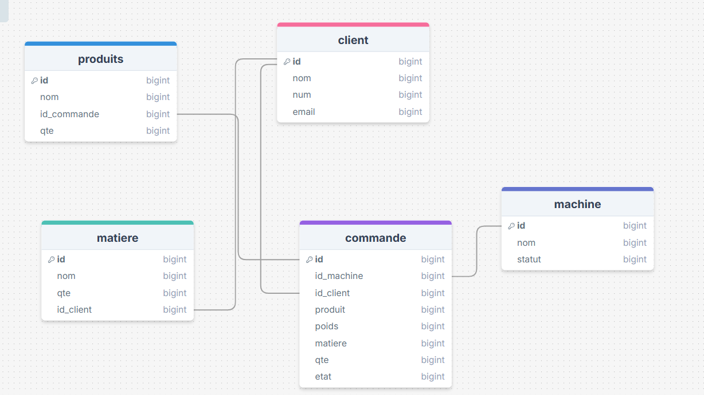

# Nettoyage d'une base de données d'usine (SQL, PostgreSQL)

TP réalisé individuellement pendant mon Bachelor Business Intelligence & Data à Nexa Digital School : repérer les problèmes de qualité dans une petite base de données (doublons, valeurs vides, valeurs négatives, écritures incohérentes) et les corriger en SQL.

## La base de données

Cinq tables : `client`, `commande`, `machine`, `matiere`, `produits` (schéma dans `schema_bdd.png`).



## Fichiers

| Fichier | Rôle |
| --- | --- |
| `01_schema.sql` | Création des tables et des clés étrangères |
| `02_donnees_brutes.sql` | Données de départ, volontairement sales |
| `03_nettoyage.sql` | Mon script de nettoyage, dans l'ordre des tables |
| `schema_bdd.png` | Schéma relationnel |

## Problèmes repérés et corrections

| Problème | Exemple | Correction |
| --- | --- | --- |
| Écriture incohérente | `Dupont` et `DUPONT`, `acier` et `Acier`, `en_cours` | `INITCAP` et `TRIM` pour uniformiser |
| Doublons | Client Dupont en double ; matières en double | `ROW_NUMBER() OVER (PARTITION BY ...)` pour garder une seule ligne |
| Valeurs négatives | Poids -5 et quantité -10 dans une commande, quantité -50 pour une matière | Remplacées par des valeurs positives |
| Valeurs manquantes | Email vide, matière NULL, statut NULL, nom de machine vide | Email vide mis à `NULL`, autres champs complétés |
| Mauvais types | Poids et quantité stockés en texte | `NUMERIC(10,2)` et `SMALLINT` avec `ALTER TABLE ... USING` |
| Valeurs libres pour un statut | `en_cours`, `En_cours`, `terminee`, vide | Types énumérés (`ENUM`) pour l'état des commandes et le statut des machines |

Point important sur les doublons de clients : avant de supprimer le client en double, le script rattache ses commandes et ses matières au client conservé, sinon les clés étrangères bloqueraient la suppression.

## Résultat

| Table | Lignes avant | Lignes après |
| --- | --- | --- |
| client | 7 | 6 |
| commande | 4 | 4 |
| machine | 5 | 5 |
| matiere | 10 | 4 |
| produits | 5 | 5 |

## Limites et suite

- Plusieurs valeurs de remplacement sont des hypothèses faites pour l'exercice (par exemple le nom `Machine B`, l'email `bernard@gmail.com` ou la matière `Bois`) : dans un vrai projet, elles viendraient du métier.
- Ce qui n'est pas encore traité : l'email `martin@@yahoo.fr` (double @), le client sans nom et avec l'email `noemail`, la quantité négative du produit n° 18, les machines 1 et 2 qui deviennent identiques, et deux commandes quasi identiques (n° 9 et 10).
- Les colonnes de texte restent en `VARCHAR` (et non `CHAR`), pour éviter les espaces ajoutés à la fin des valeurs.

## Lancer le projet

Avec PostgreSQL installé, dans une base vide :

```
psql -d ma_base -f 01_schema.sql
psql -d ma_base -f 02_donnees_brutes.sql
psql -d ma_base -f 03_nettoyage.sql
```

## Outils

SQL, PostgreSQL, drawSQL pour le schéma.
